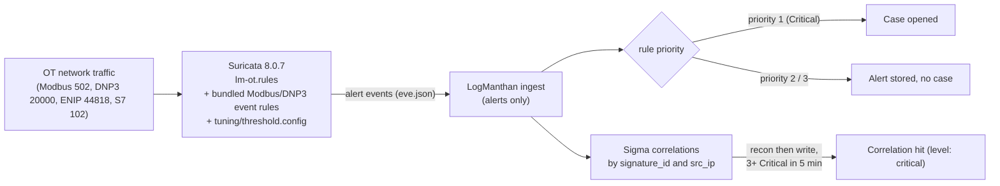
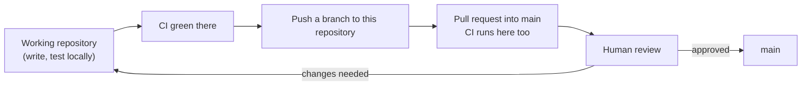

# LogManthan OT detection rules

Detection rules for industrial (OT) networks, written for the LogManthan SOC platform, together with
the tests and the Docker lab used to prove them.

This guide is written for someone joining the team with no background in this repository. If you
follow it from top to bottom you will have the tests running, the lab up, every attack scenario
fired and checked, and you will know how to add a rule of your own.

Maintainer: Ankit Raj Choudhari.

## Contents

1. [What this is](#1-what-this-is)
2. [How it fits into LogManthan](#2-how-it-fits-into-logmanthan)
3. [Repository layout](#3-repository-layout)
4. [Prerequisites](#4-prerequisites)
5. [Quick start (5 minutes)](#5-quick-start-5-minutes)
6. [The rules](#6-the-rules)
7. [How the tests work](#7-how-the-tests-work)
8. [The OT lab, step by step](#8-the-ot-lab-step-by-step)
9. [Cyber-range exercise](#9-cyber-range-exercise)
10. [Tuning Suricata's built-in Modbus/DNP3 alerts](#10-tuning-suricatas-built-in-modbusdnp3-alerts)
11. [Sigma correlations](#11-sigma-correlations)
12. [How to add a new rule](#12-how-to-add-a-new-rule)
13. [CI](#13-ci)
14. [How changes reach this repository](#14-how-changes-reach-this-repository)
15. [Security rules](#15-security-rules)
16. [Troubleshooting and FAQ](#16-troubleshooting-and-faq)
17. [Credits and licence](#17-credits-and-licence)

---

## 1. What this is

- **Suricata rules** for two industrial protocols, **Modbus/TCP** and **DNP3**, plus one rule each for
  EtherNet/IP, Siemens S7comm and IT-to-OT remote access. 19 rules in total, SIDs 9100001 to 9100040.
- **Tuning** for the Modbus and DNP3 event rules that ship with Suricata, which are very noisy on real traffic.
- **Sigma correlations** that look for multi-step attacks across those alerts.
- **Tests** that load every rule into Suricata, replay recorded traffic, and check that exactly the
  right alerts fire, and that nothing fires on normal traffic.
- **A Docker lab**: a small plant with a Modbus PLC and HMI, a DNP3 outstation and master, an attacker
  and a Suricata sensor. Each attack can be run on demand and its alert checked.

Everything is tested on **Suricata 8.0.7**, the version LogManthan runs in production.

## 2. How it fits into LogManthan

LogManthan does not look at network traffic itself. It **ingests Suricata alerts only**. So all
protocol detection has to happen in Suricata, and anything clever (sequences, bursts) is done by Sigma
on top of those alerts.



Facts to keep in mind:

| Fact | What it means for you |
|---|---|
| LogManthan ingests Suricata **alerts only** | No flow, protocol or packet logs reach it. If Suricata does not alert, LogManthan never sees it. |
| Only **priority 1** opens a case | Use priority 1 only for actions that change the process or blind the operator (writes, restarts, listen-only, stop, delete, disabling alarms). Recon is priority 2. |
| Suricata's Modbus, DNP3 and ENIP parsers are **off by default** | Each site must set `app-layer.protocols.modbus.enabled: yes` (and `dnp3`, `enip`) in `suricata.yaml`, or the protocol rules never match. |
| Suricata has **no S7comm or IEC-104 parser** | The S7 rule matches raw bytes on TCP 102. There is no IEC-104 rule. |
| Rules are **alert-only** | No `drop`, `reject` or `pass`. Nothing is blocked or isolated automatically. |

## 3. Repository layout

| Path | What it is |
|---|---|
| `suricata/ot/lm-ot.rules` | All LM-OT Suricata rules (Modbus, DNP3, ENIP, S7comm, IT to OT). |
| `SIDS.md` | SID registry: every SID, its message, priority, MITRE technique and the tests that cover it. |
| `tuning/threshold.config` | Rate limits for Suricata's bundled Modbus/DNP3 event rules. |
| `tuning/README.md` | Why each limit exists, with before/after numbers. |
| `sigma/rules/base/` | Three Sigma building-block rules (recon, write/control, all priority 1). |
| `sigma/rules/correlations/` | Two Sigma correlation rules (recon then write, priority 1 burst). |
| `sigma/pipelines/logmanthan-fields.yml` | The one place Sigma field names are defined. |
| `sigma/requirements.txt` | Sigma tools, pinned by version and SHA-256. |
| `sigma/README.md` | Sigma details. |
| `scripts/test_suricata.py` | Suricata test runner: lint, `suricata -T`, replay, tuning. Standard library only. |
| `scripts/test_sigma.py` | Sigma test runner: `sigma check`, field names, SID sync, correlation scenarios. |
| `scripts/build_sigma_events.py` | Rebuilds (or checks) the Sigma test events from the lab captures. |
| `tests/suricata/fixtures.json` | Every test capture: where it is, its SHA-256 and which SIDs must (or must not) fire. |
| `tests/suricata/tuning.json` | Event-alert limits per capture for the tuning test. |
| `tests/suricata/lab/` | Our own lab captures (13 pcaps), one per scenario plus two normal-traffic baselines. |
| `tests/sigma/events/` | Suricata alerts replayed from the lab captures, used as Sigma test input. |
| `tests/sigma/scenarios.json` | Correlation scenarios and their expected results. |
| `lab/docker-compose.yml` | The OT lab: network, containers and hardening. |
| `lab/plc-modbus/` | Modbus PLC (pymodbus server). |
| `lab/hmi/` | HMI that polls the PLC and writes a setpoint every 30 s. |
| `lab/dnp3-outstation/` | DNP3 outstation (RTU). |
| `lab/dnp3-master/` | DNP3 master doing normal class polling. |
| `lab/attacker/` | Attack traffic generator (`attack.py`), one scenario per run. |
| `lab/common/` | Shared code: `dnp3.py` (minimal DNP3 implementation) and `labnet.py` (target guard). |
| `lab/suricata/` | The lab sensor's `suricata.yaml`, `classification.config`, `threshold.config` and `run.sh`. |
| `lab/capture/` | tcpdump container used by `make capture`. |
| `lab/tools/alerts.py` | Prints and checks LM-OT alerts from `lab/out/eve.json`. |
| `lab/tools/record_fixtures.sh` | Re-records all lab test captures. |
| `lab/README.md` | Lab reference (topology, hardening). |
| `Makefile` | Every command you need: tests, Sigma, lab. |
| `.github/workflows/test.yml` | CI: gitleaks, then all tests in the pinned Suricata 8.0.7 container. |
| `.pre-commit-config.yaml` | gitleaks as a pre-commit hook. |
| `.gitattributes` | Forces LF line endings everywhere. |
| `SECURITY.md` | How to report a problem, and what must never be committed. |
| `ATTRIBUTION.md` | Credits for third-party captures. |
| `LICENSE` | Detection Rule License 1.1. |

## 4. Prerequisites

| Tool | Version used | Why |
|---|---|---|
| Git | 2.55 | Clone the repository. |
| Docker Desktop (or Docker Engine + Compose v2) | Docker 29.6, Compose v5.3 | Tests run inside the Suricata 8.0.7 image; the lab runs in containers. |
| GNU make | 4.4 | All commands are `make` targets. |
| Python | 3.11 or newer (3.14 used here) | Only for the Sigma tests. The Suricata tests run inside the container. |

You do **not** need Suricata installed locally. The tests use the same container image as CI.

### Windows notes

- **Use Git Bash** to run `make`. Git Bash rewrites paths like `/src` into Windows paths, which breaks
  `docker run -v ...:/src`. The Makefile sets `MSYS_NO_PATHCONV=1` for you. If you type a `docker`
  command by hand in Git Bash, put `MSYS_NO_PATHCONV=1` in front of it.
- **Line endings.** `.gitattributes` forces LF for every text file, so a normal `git clone` is fine
  even with `core.autocrlf=true`. Make sure your editor keeps LF when you save rule files and shell scripts.
- **make** is not installed with Git for Windows. Install it with:
  ```sh
  winget install ezwinports.make
  ```
- **Python** on Windows is usually `python`, not `python3`. Pass `PYTHON=python` to `make sigma-setup`.
- Start Docker Desktop before running any `make` target, and wait until `docker info` answers.

## 5. Quick start (5 minutes)

```sh
git clone https://github.com/DeepTrustx-AI/logmanthan-rules.git
cd logmanthan-rules
make test
```

The first run pulls the Suricata image and downloads the external captures into `.cache/`. After
that it takes about 40 seconds. The end of the output should look like this (shortened):

```text
== Lint ==
  19 rules checked, 0 problems
== Static (suricata -T) ==
  This is Suricata version 8.0.7 RELEASE
  PASS: rules load (0 warnings, 0 ignored)
== Dynamic (pcap replay) ==
  PASS dnp3_cold_restart_and_response expected=fire:[9100010] got=[9100010]
  ...
  PASS lab_write expected=exact:[9100001] got=[9100001]
  ...
  PASS lab_dnp3_master_normal expected=silent:[] got=[] decoded=dnp3
26/26 dynamic tests passed
== Tuning (bundled Modbus/DNP3 event rules + tuning/threshold.config) ==
  ...
  total event alerts: 15475 before -> 25 after tuning
  PASS: event-alert volume within limits, nothing silenced, LM-OT SIDs unchanged
```

Then the Sigma tests:

```sh
make sigma-setup PYTHON=python   # once; on Linux/macOS just: make sigma-setup
make sigma-test
```

```text
== Sigma check ==
  sigma-cli 4.0.0, pySigma 2.0.3
  Found 0 errors, 0 condition errors and 0 issues.
  PASS: sigma check exited 0
  3 base rules, 2 correlation rules
== Field names (sigma/pipelines/logmanthan-fields.yml) ==
  PASS: every field the rules use is defined in the pipeline
== Sync with suricata/ot/lm-ot.rules ==
  PASS lm_ot_priority1 lists exactly the 13 priority:1 rules
== Correlation scenarios (tests/sigma/scenarios.json) ==
  ...
18/18 scenarios passed
```

If all of that passes, your setup is correct.

## 6. The rules

All rules live in `suricata/ot/lm-ot.rules`. Every rule has a message starting with `LM-OT`, a
`classtype`, a `priority`, `metadata:mitre_ics Txxxx`, a `sid` and a `rev`. The test suite enforces this.

### Priority

| Priority | LogManthan severity | Opens a case? | Used for |
|---|---|---|---|
| 1 | Critical | **Yes** | Writes, restarts, listen-only, PLC stop, file delete, disabling alarms, IT-to-OT remote access |
| 2 | Medium | No, alert only (and input for Sigma) | Recon, discovery, scans, floods |
| 3 | Low | No | Not used yet |

### All SIDs

| SID | Message (after `LM-OT`) | Priority | MITRE ATT&CK for ICS | Covered by test |
|---|---|---|---|---|
| 9100001 | Modbus write from unauthorised host | 1 | T0855, T0836 | `bro_modbus_modbus`, `lab_write` |
| 9100002 | Modbus diagnostics Force Listen Only Mode (device goes silent) | 1 | T0814 | `bro_modbus_modbus`, `lab_listen_only` |
| 9100003 | Modbus diagnostics Restart Communications | 1 | T0816 | `bro_modbus_modbus`, `lab_restart_comms` |
| 9100004 | Modbus Read Device Identification (fingerprinting) | 2 | T0846 | `bro_modbus_modbus`, `lab_scan` |
| 9100005 | Modbus user-defined or reserved function code | 2 | T0855 | **none yet** |
| 9100006 | Modbus scan - many connections from one host | 2 | T0846 | `lab_scan` |
| 9100007 | Modbus request flood from unknown host | 2 | T0814 | `lab_flood`, `lab_flood_heavy` |
| 9100008 | Modbus request flood from any host (incl. allowed writers) | 2 | T0814 | `lab_flood_heavy`, `lab_flood_heavy_allowed_writer` |
| 9100010 | DNP3 Cold Restart command | 1 | T0816 | `dnp3_cold_restart_and_response`, `lab_dnp3_cold_restart` |
| 9100011 | DNP3 Warm Restart command | 1 | T0816 | `dnp3_warm_restart_and_response`, `lab_dnp3_warm_restart` |
| 9100012 | DNP3 Direct Operate from non-master | 1 | T0855 | `dnp3_directoperate_and_response`, `dnp3_direct_operate_analog_output`, `lab_dnp3_direct_operate` |
| 9100013 | DNP3 Write from non-master | 1 | T0836 | `dnp3_write_binary_output`, `lab_dnp3_write` |
| 9100014 | DNP3 Select (control) from non-master | 1 | T0855 | `dnp3_select_operate_and_responses` |
| 9100015 | DNP3 Operate from non-master | 1 | T0855 | `dnp3_select_operate_and_responses` |
| 9100016 | DNP3 Disable Unsolicited Responses (operator loses alarms) | 1 | T0878 | `dnp3_disable_unsolcited_and_response`, `lab_dnp3_disable_unsolicited` |
| 9100017 | DNP3 Delete File on outstation | 1 | T0809 | `dnp3_file_delete` |
| 9100020 | ENIP List Identity discovery from non-engineering host | 2 | T0846 | `EthernetIP_enip_test` |
| 9100030 | S7comm PLC STOP request | 1 | T0858, T0816 | **none yet** |
| 9100040 | Remote service connection from IT into OT | 1 | T0886 | **none yet** |

**Not yet tested:** 9100005, 9100030 and 9100040. They load cleanly in Suricata, but no capture
proves they fire. The S7 rule in particular matches raw byte offsets and must be checked against a
real S7 capture before anyone relies on it.

Tests that must stay **silent** (no LM-OT alert at all): `dnp3_read_and_response`, `lab_hmi_normal`,
`lab_dnp3_master_normal`. And `iti_modbustcp_master_allowed` must not raise 9100007 or 9100008.

### Address groups

Rules never contain real IP addresses. They use five address groups, which each site sets in its own
`suricata.yaml` under `vars.address-groups`. Site values are **never** committed to this repository.

| Group | Meaning | Used by | Lab value |
|---|---|---|---|
| `OT_NET` | PLC, RTU and field-device subnets (Purdue levels 0-1) | Destination of every rule | `[10.10.1.10,10.10.1.11]` |
| `OT_WRITERS` | Hosts allowed to write to PLCs (HMI, SCADA server, engineering workstation) | 9100001, 9100006, 9100007 | `[10.10.1.20]` |
| `ENG_WS` | Engineering workstations, allowed to program and discover devices | 9100004, 9100020, 9100030 | `[10.10.1.30]` |
| `DNP3_MASTERS` | SCADA masters allowed to send DNP3 control commands | 9100012 to 9100016 | `[10.10.1.40]` |
| `IT_NET` | Corporate IT networks (Purdue levels 4-5) | 9100040 | `[10.10.1.128/25]` |

A site sets them like this (example values only):

```yaml
vars:
  address-groups:
    OT_NET: "[192.0.2.0/24]"
    OT_WRITERS: "[192.0.2.50,192.0.2.51]"
    ENG_WS: "[192.0.2.60]"
    DNP3_MASTERS: "[192.0.2.70]"
    IT_NET: "[198.51.100.0/24]"
app-layer:
  protocols:
    modbus: { enabled: yes }
    dnp3:   { enabled: yes }
    enip:   { enabled: yes }
```

If `OT_WRITERS` or `DNP3_MASTERS` is too narrow, legitimate HMIs and masters will open cases. If it is
too wide, attacks from inside the allowed list are missed. Getting these lists right at each site
matters more than any single rule.

### SID range

SIDs 9100001 to 9199999 are reserved for these rules. A SID is **never reused**. When a rule is
retired, mark its row in `SIDS.md` as *retired* instead of deleting it.

## 7. How the tests work

`make test` runs `scripts/test_suricata.py` inside the Suricata 8.0.7 container (the same image as
CI, pinned by digest). It has four stages. **Any Suricata warning or error line fails the run**, even
if Suricata exits 0.

| Stage | What it checks | Fails when |
|---|---|---|
| 1. Lint | Every rule against the repo conventions | Missing `LM-OT` prefix, `classtype`, `priority`, `metadata:mitre_ics`, `sid` or `rev`; uses Lua; is not an `alert`; SID out of range, reused or not in `SIDS.md`; classtype not defined in `lab/suricata/classification.config` |
| 2. Static | `suricata -T` on all rule files | Any warning or error. The only allowed exceptions are listed, with a reason, in `IGNORED_WARNINGS` in the script. |
| 3. Dynamic | Replays every capture in `fixtures.json` | Wrong SIDs fire, expected SIDs do not fire, a SHA-256 does not match, or Suricata warns |
| 4. Tuning | Replays every capture with the bundled event rules, with and without `tuning/threshold.config` | Event alerts go above the limit in `tuning.json`, an event is silenced completely, LM-OT SIDs change, or the Suricata version differs from the one the limits were measured on |

### The fixture format

Each entry in `tests/suricata/fixtures.json` describes one capture. An external one:

```json
{
  "id": "dnp3_cold_restart_and_response",
  "url": "https://raw.githubusercontent.com/ITI/ICS-Security-Tools/master/pcaps/dnp3/cold_restart_and_response.pcap",
  "sha256": "657d7ce09263e193c1b31c2eb60e50700e61a9088a03124184db16588577e64f",
  "expect": "fire",
  "expect_sids": [9100010]
}
```

A lab capture:

```json
{
  "id": "lab_write",
  "path": "tests/suricata/lab/lab_write.pcap",
  "sha256": "1d9c50aa6dac4b089b87549fbfd56f91c38d7670248f6ea5e58967ce7ee5a96f",
  "vars": "lab",
  "expect": "fire",
  "expect_sids": [9100001],
  "exact": true
}
```

| Field | Meaning |
|---|---|
| `id` | Test name, shown in the output and referenced in `SIDS.md`. |
| `url` | External capture. Downloaded into `.cache/` at test time, never committed. |
| `path` | Capture stored in this repository (lab captures only). |
| `sha256` | Checked before every use. A changed file fails the test. |
| `expect` | `fire`: every SID in `expect_sids` must fire. `silent`: no LM-OT SID may fire. `absent`: none of `expect_sids` may fire (other SIDs may). |
| `exact` | With `fire`: no other LM-OT SID may fire either. All lab captures use this. |
| `app_proto` | Every flow must be decoded as this protocol, with no anomaly events. Used for the DNP3 lab captures, to prove our lab DNP3 is valid DNP3. |
| `vars` | Which address-group set to use, from `var_sets` at the top of the file. Without it, the top-level `vars` are used. |

The top-level `vars` use the documentation range `203.0.113.0/24`. The `lab` set uses the lab
addresses. `lab_compromised_writer` adds the attacker to `OT_WRITERS`, to test 9100008 (a flood from a
compromised allowed host). `iti_master_allowed` puts every non-test host in `OT_WRITERS`, to prove a
busy real master does not trigger the flood rules.

### External captures and lab captures

- **External** captures come from ITI ICS-Security-Tools (CC BY 4.0). They are fetched by URL and
  pinned by SHA-256, so the repository never stores third-party files.
- **Lab** captures are recorded from our own Docker lab (`make record-fixtures`, see section 8) and
  are the only pcaps committed (`tests/suricata/lab/`, 13 files).

### Why replays run single-threaded

The threshold rules (9100006, 9100007, 9100008) count packets per source over a time window. With
several worker threads, the same capture gave different counts from run to run. Replays therefore
use `--runmode single`, so every run gives the same result.

### Other details

- Suricata settings are passed with `--set` (parsers on, `stream.midstream=true`,
  `security.lua.allow-rules=false`). There is no custom `suricata.yaml` for the tests.
- `make sigma-events CHECK=1` checks that the Sigma test events still match a fresh Suricata replay
  of the lab captures. CI runs this too.

## 8. The OT lab, step by step

### Topology

One internal Docker network, `otlab`, `10.10.1.0/24`.

| Host | IP | Role | Address group |
|---|---|---|---|
| `plc-modbus` | 10.10.1.10 | Modbus PLC on port 502 (coils 0-99, holding registers 0-99) | `OT_NET` |
| `dnp3-outstation` | 10.10.1.11 | DNP3 outstation on port 20000, link address 10 | `OT_NET` |
| `hmi` | 10.10.1.20 | Reads registers and coils every 1 s, writes a setpoint to HR0 every 30 s | `OT_WRITERS` |
| *(empty slot)* | 10.10.1.30 | Engineering workstation | `ENG_WS` |
| `dnp3-master` | 10.10.1.40 | DNP3 master: integrity poll every 60 s, event poll every 2 s | `DNP3_MASTERS` |
| `attacker` | 10.10.1.66 | Started only when you run an attack | none |
| `suricata` | host network | Sensor on the `otlab0` bridge, writes `lab/out/eve.json` | |

### Step 1: start the lab

```sh
make lab-up
```

This builds and starts the PLC, HMI, DNP3 outstation, DNP3 master and the Suricata sensor. Check
they are up:

```sh
make lab-logs
```

You should see lines like these:

```text
plc-modbus-1       | ... plc listening on 0.0.0.0:502
hmi-1              | ... hmi connected to 10.10.1.10:502
dnp3-outstation-1  | ... outstation listening on port 20000, link address 10
dnp3-master-1      | ... master connected to 10.10.1.11:20000
suricata-1         | i: threads: Threads created -> W: 8 FM: 1 FR: 1   Engine started.
```

### Step 2: check the baseline is quiet

Normal HMI and DNP3 master traffic must not raise any priority 1 alert. Wait about 30 seconds, then:

```sh
make alerts ARGS="--forbid-priority 1"
```

```text
--- 0 LM-OT alerts
PASS no priority:1 alerts (found 0)
```

### Step 3: run the attacks

Run one scenario, then check its alert. `--src 10.10.1.66` limits the output to the attacker and
`--expect` makes the command fail if the SID is missing. Add `--since <UTC time>` to look at one run only.

| Command | What it sends | Expected SID | Priority |
|---|---|---|---|
| `make attack SCENARIO=scan` | Sweep of the lab on port 502, then 25 connections with FC43 Read Device Identification | 9100006, 9100004 | 2, 2 |
| `make attack SCENARIO=write` | FC6 write HR0 = 9999, FC16 write HR10-14 | 9100001 | 1 |
| `make attack SCENARIO=listen-only` | FC8 sub-function 4, Force Listen Only Mode | 9100002 | 1 |
| `make attack SCENARIO=restart-comms` | FC8 sub-function 1, Restart Communications | 9100003 | 1 |
| `make attack SCENARIO=flood` | 1000 FC3 reads over 4 connections | 9100007 | 2 |
| `make attack SCENARIO="flood --count 3000"` | 3000 FC3 reads over 4 connections | 9100007, 9100008 | 2, 2 |
| `make attack SCENARIO=dnp3-cold-restart` | DNP3 FC13 Cold Restart | 9100010 | 1 |
| `make attack SCENARIO=dnp3-warm-restart` | DNP3 FC14 Warm Restart | 9100011 | 1 |
| `make attack SCENARIO=dnp3-direct-operate` | DNP3 FC5 Direct Operate (CROB, output 0) | 9100012 | 1 |
| `make attack SCENARIO=dnp3-write` | DNP3 FC2 Write (time and date) | 9100013 | 1 |
| `make attack SCENARIO=dnp3-disable-unsolicited` | DNP3 FC21 Disable Unsolicited, classes 1-3 | 9100016 | 1 |

Example, the write attack:

```sh
make attack SCENARIO=write
```

```text
attacker: scenario=write target=10.10.1.10
attacker: FC6 write HR0 = 9999
attacker: FC16 write HR10-14
attacker: done
```

```sh
make alerts ARGS="--src 10.10.1.66 --expect 9100001"
```

```text
2026-11-24T03:40:54  sid=9100001  p1  10.10.1.66:60096 -> 10.10.1.10:502  LM-OT Modbus write from unauthorised host
2026-11-24T03:40:54  sid=9100001  p1  10.10.1.66:60096 -> 10.10.1.10:502  LM-OT Modbus write from unauthorised host
--- 2 LM-OT alerts
  9100001  priority:1  x2  LM-OT Modbus write from unauthorised host
PASS expect sid 9100001
```

The scan, summarised:

```text
--- 26 LM-OT alerts
  9100004  priority:2  x25  LM-OT Modbus Read Device Identification (fingerprinting)
  9100006  priority:2  x1  LM-OT Modbus scan - many connections from one host
PASS expect sid 9100006
PASS expect sid 9100004
```

The heavy flood:

```text
attacker: flood: 3000 of 3000 requests answered over 4 connections
...
  9100007  priority:2  x1  LM-OT Modbus request flood from unknown host
  9100008  priority:2  x1  LM-OT Modbus request flood from any host (incl. allowed writers)
PASS expect sid 9100007
PASS expect sid 9100008
```

A DNP3 attack:

```text
attacker: DNP3 cold restart sent to 10.10.1.11: response IIN 90 00
...
2026-11-24T03:43:51  sid=9100010  p1  10.10.1.66:37500 -> 10.10.1.11:20000  LM-OT DNP3 Cold Restart command
PASS expect sid 9100010
```

`make alerts` options: `--since YYYY-MM-DDTHH:MM:SS` (UTC), `--src IP`, `--expect SID` (repeatable),
`--forbid-priority N`, `--quiet`. It exits with code 1 if an expectation fails.

### Step 4: record traffic

To save lab traffic to a pcap (for example to build a new test), start a capture and run an attack
while it runs:

```sh
make capture NAME=write DURATION=20 HOST=10.10.1.66   # in one terminal
make attack SCENARIO=write                            # in another, within 20 s
```

```text
tcpdump: listening on otlab0, link-type EN10MB (Ethernet), snapshot length 262144 bytes
12 packets captured
12 packets received by filter
0 packets dropped by kernel
capture: done (1083 bytes)
```

The file is `lab/out/write.pcap`. `lab/out/` is ignored by git.

To re-record **all** the committed lab test captures in one go:

```sh
make record-fixtures
```

This overwrites the pcaps in `tests/suricata/lab/` and prints a new SHA-256 for each. Copy those into
`tests/suricata/fixtures.json`, run `make test` and `make sigma-events` (the Sigma test events come
from the same captures). Only do this when a capture really needs to change.

### Step 5: stop the lab

```sh
make lab-down
```

### Lab safety

The lab generates attack traffic, so it is locked down:

- The `otlab` network is `internal`: containers cannot reach the internet or your LAN.
- The bridge has **no IP address**, so the Docker host is not reachable from the lab at 10.10.1.1.
- **No ports are published** to your machine. No container is privileged.
- The attacker, HMI and DNP3 master **refuse any target outside 10.10.1.0/24**, and also the network,
  gateway and broadcast addresses, before opening a socket. You can check it yourself:

  ```sh
  MSYS_NO_PATHCONV=1 docker run --rm --network none otlab/attacker:local write --target 10.10.1.1
  ```

  ```text
  REFUSED: target '10.10.1.1' -> 10.10.1.1 is the lab network, gateway or broadcast address
  ```
- Lab containers run as a non-root user with a read-only filesystem, all capabilities dropped and
  `no-new-privileges`. The sensor has `NET_RAW` only.

More detail is in [lab/README.md](lab/README.md).

## 9. Cyber-range exercise

The lab doubles as a training exercise. The instructor starts the lab, runs the scenarios in any
order and does not say which. The trainee only gets `make alerts` and answers the tasks below.
Reset between rounds with `make lab-down && make lab-up`.

### Tasks

1. Which host is the attacker? How can you tell from the alerts alone?
2. Which alerts would open a case in LogManthan, and which are context only?
3. In the `scan` scenario the attacker sweeps every lab address on port 502. Why do only the
   connections to the PLC count towards 9100006?
4. Why does `flood` raise 9100007 but not 9100006?
5. The HMI writes HR0 every 30 seconds too. Why does only the attacker's write raise 9100001?
6. After `listen-only` on a real PLC, what would the operator see on the HMI, and why is that dangerous?
7. The DNP3 attacks reuse the real master's link address (1). How does Suricata still tell them apart?
8. 9100012 (Direct Operate) excludes `DNP3_MASTERS`, but 9100010 (Cold Restart) does not. Why?
9. After the full set of attacks, which Sigma correlations would fire, and for which host?
10. Give the MITRE ATT&CK for ICS technique for each alert you saw.

### Expected answers

1. **10.10.1.66.** Every LM-OT alert has that source address. The HMI (10.10.1.20) and the DNP3
   master (10.10.1.40) raise none.
2. **Case (priority 1):** 9100001, 9100002, 9100003, 9100010, 9100011, 9100012, 9100013, 9100016.
   **Context only (priority 2):** 9100004, 9100006, 9100007, 9100008.
3. The rule's destination is `$OT_NET 502`. In the lab `OT_NET` is only 10.10.1.10 and 10.10.1.11, so
   connections to other addresses do not match.
4. 9100006 counts new connections (20 SYNs in 60 s). The flood sends 1000 requests over only 4
   connections. 9100007 counts requests (300 in 10 s from a host that is not in `OT_WRITERS`).
5. 9100001 matches only sources that are **not** in `OT_WRITERS`. The HMI is in `OT_WRITERS`.
6. The PLC stops answering, so the HMI shows stale values or a communication failure. The process
   keeps running but the operator can neither see nor control it until Restart Communications or a
   power cycle. In the lab the pymodbus PLC keeps answering, so only the detection is exercised.
7. By the **source IP**. DNP3 has no authentication (without Secure Authentication), so link
   addresses can be copied. The rules use `!$DNP3_MASTERS` on the source address.
8. A cold restart takes the outstation down whoever sends it. It is Critical even from the real
   master, so the rule matches any source.
9. Both, for **10.10.1.66**: `lm_ot_recon_then_write` (the scan, then a write within 10 minutes) and
   `lm_ot_priority1_burst` (3 or more Critical alerts within 5 minutes). The `lab_timeline` scenario in
   `make sigma-test` shows this.
10.

    | SID | Technique |
    |---|---|
    | 9100001 | T0855 Unauthorized Command Message, T0836 Modify Parameter |
    | 9100002 | T0814 Denial of Service |
    | 9100003 | T0816 Device Restart/Shutdown |
    | 9100004, 9100006 | T0846 Remote System Discovery |
    | 9100007, 9100008 | T0814 Denial of Service |
    | 9100010, 9100011 | T0816 Device Restart/Shutdown |
    | 9100012 | T0855 Unauthorized Command Message |
    | 9100013 | T0836 Modify Parameter |
    | 9100016 | T0878 Alarm Suppression |

## 10. Tuning Suricata's built-in Modbus/DNP3 alerts

LogManthan's Suricata also loads the event rules that come with Suricata: `modbus-events.rules`
(SIDs 2250001-2250009) and `dnp3-events.rules` (SIDs 2270000-2270007). They flag protocol anomalies,
and on real Modbus traffic they fire thousands of times.

`tuning/threshold.config` limits them **without switching any of them off**:

- every event alerts at most **once per source per 5 minutes**;
- "Data mismatch" (2250008) alerts at most **once per source per hour** (see below).

The LM-OT rules are not touched. The test fails if `threshold.config` ever names one.

### Before and after

Measured by `make test` on Suricata 8.0.7:

| Capture | Before | After | Limit |
|---|---:|---:|---:|
| ITI `ModbusTCP.pcap` (85 s) | 6331 | 19 | 19 |
| ITI `bro/modbus/modbus.pcap` (35 min) | 5017 | 3 | 3 |
| lab `lab_flood` | 1000 | 1 | 1 |
| lab `lab_flood_heavy` | 3000 | 1 | 1 |
| lab `lab_hmi_normal` (130 s of normal HMI) | 127 | 1 | 1 |
| 20 other captures | 0 | 0 | 0 |
| **Total** | **15475** | **25** | |

```text
  PASS iti_modbustcp                            6331     19     19  2250002:2 2250003:2 2250006:2 2250008:13
  PASS bro_modbus_modbus                        5017      3      3  2250008:2 2250009:1
  ...
  total event alerts: 15475 before -> 25 after tuning
```

### The "Data mismatch" problem (sawp-modbus issue #13)

Suricata 8.0.7 flags **every** FC3/FC4 (read registers) response as a data mismatch, even correct
ones. Our lab PLC answers "read 10 registers" with 20 data bytes, exactly as the Modbus spec says, and
every one of those responses still alerts.

The cause is a bug in sawp-modbus, the Modbus parser Suricata uses:
[CybercentreCanada/sawp issue #13](https://github.com/CybercentreCanada/sawp/issues/13). Register-read
responses are checked with the coil formula. It is fixed on sawp `main` (commit `7f33f7e`) but not in
a release yet, and Suricata 8.0.7 ships sawp-modbus 0.13.1.

The event is not disabled, because on coil and discrete-input traffic it may be a real mismatch.
Once an hour per source keeps that signal.

**TODO(rajeev):** set 2250008 back to 300 seconds once a Suricata release includes sawp `7f33f7e`.
`tests/suricata/tuning.json` records the Suricata version the limits were measured on, so the test
fails on a new Suricata until the limits are re-measured.

**TODO(rajeev):** decide how this file reaches LogManthan's Suricata: point `threshold-file:` at it,
or merge its lines into LogManthan's existing `threshold.config`. Load it together with **both** bundled
rule files, or Suricata warns about unknown SIDs.

More detail: [tuning/README.md](tuning/README.md).

## 11. Sigma correlations

The Sigma rules never see network traffic. They read LM-OT **alerts** and match them by
`signature_id`.

| Rule | Type | What it detects |
|---|---|---|
| `lm_ot_recon` | base | Recon alerts: 9100004, 9100006, 9100020 |
| `lm_ot_write_control` | base | Write and control alerts: 9100001, 9100012 to 9100015 |
| `lm_ot_priority1` | base | Every priority 1 LM-OT rule (13 SIDs) |
| `lm_ot_recon_then_write` | correlation, `temporal_ordered` | Recon **then** write/control from the same `src_ip` within **10 minutes** |
| `lm_ot_priority1_burst` | correlation, `event_count` | **3 or more** priority 1 alerts from the same `src_ip` within **5 minutes** |

Both correlations are `level: critical`. The base rules are only building blocks, since Suricata
already raises those alerts.

### Field names

The rules use logical field names (`signature_id`, `src_ip`). The real LogManthan names are not
confirmed yet, so they are defined in one place only:
`sigma/pipelines/logmanthan-fields.yml`. The test fails if a rule uses a field that file does not list.

### Running the tests

```sh
make sigma-setup PYTHON=python   # once (Windows); plain `make sigma-setup` elsewhere
make sigma-test
make sigma-events CHECK=1        # test events still match a fresh Suricata replay
```

`make sigma-test` runs `sigma check`, checks the field names, checks that `lm_ot_priority1` lists
exactly the priority 1 rules in `lm-ot.rules`, and runs 18 correlation scenarios built from real lab
alerts (inside and outside each time window, wrong order, a different host, baselines).

### Open items

- **TODO(rajeev):** confirm the field names and the logsource (`product: suricata`, `service: alert`)
  in `sigma/pipelines/logmanthan-fields.yml`.
- **TODO(rajeev):** replay `tests/sigma/events/` through LogManthan's own Sigma engine. The scenario test
  uses a small reference evaluator, not LogManthan's engine.

More detail: [sigma/README.md](sigma/README.md).

## 12. How to add a new rule

The steps below were run for a real example: a rule for DNP3 **Stop Application** (function code 18),
which an attacker could use to stop an application on an outstation.

### Step 1: pick a SID

Open `SIDS.md` and take the next free SID in the protocol's block. DNP3 uses 91000xx from 9100010
upwards; 9100017 is the last one taken, so the new rule gets **9100018**. Never reuse a SID.

### Step 2: create a branch

```sh
git checkout -b rule/9100018-dnp3-stop-app
```

### Step 3: write the rule

Add it to `suricata/ot/lm-ot.rules` under the DNP3 section:

```text
alert dnp3 !$DNP3_MASTERS any -> $OT_NET any (msg:"LM-OT DNP3 Stop Application from non-master"; dnp3_func:18; classtype:attempted-dos; metadata:mitre_ics T0881, lm_severity critical; priority:1; sid:9100018; rev:1;)
```

Checklist:

| Part | Rule |
|---|---|
| Action | Always `alert`. |
| Source / destination | Address groups only, never IPs. Exclude the allowed hosts (`!$DNP3_MASTERS`, `!$OT_WRITERS`, `!$ENG_WS`) when legitimate hosts do this too. |
| `msg` | Starts with `LM-OT`, then protocol, then what happened. |
| `classtype` | One defined in `lab/suricata/classification.config`: `attempted-recon`, `attempted-dos`, `policy-violation` or `protocol-command-decode`. A new classtype must be added there first. |
| `priority` | 1 only if it changes the process or blinds the operator; otherwise 2. |
| `metadata` | `mitre_ics Txxxx` for each technique, plus `lm_severity`. |
| `sid`, `rev` | The new SID, `rev:1`. Bump `rev` on every later change. |

### Step 4: run the tests and read the failure

```sh
make test
```

```text
== Lint ==
  LINT FAIL suricata/ot/lm-ot.rules:67: sid 9100018 not registered in SIDS.md
  20 rules checked, 1 problems
```

This is expected: the SID is not registered yet.

### Step 5: register the SID

Add a row to `SIDS.md`, in SID order:

```text
| 9100018 | LM-OT DNP3 Stop Application from non-master | 1 | T0881 | **none yet** |
```

```sh
make test
```

```text
== Lint ==
  20 rules checked, 0 problems
== Static (suricata -T) ==
  PASS: rules load (0 warnings, 0 ignored)
== Dynamic (pcap replay) ==
26/26 dynamic tests passed
== Tuning (bundled Modbus/DNP3 event rules + tuning/threshold.config) ==
  PASS: event-alert volume within limits, nothing silenced, LM-OT SIDs unchanged
```

### Step 6: update Sigma (priority 1 rules only)

```sh
make sigma-test
```

```text
  FAIL lm_ot_priority1 differs from priority:1 rules: missing [9100018], extra []
```

Add `- 9100018` to the `signature_id` list in `sigma/rules/base/lm_ot_priority1.yml`. If the rule is
recon or write/control, add it to `lm_ot_recon.yml` or `lm_ot_write_control.yml` as well.

```text
  PASS lm_ot_priority1 lists exactly the 14 priority:1 rules
...
18/18 scenarios passed
```

### Step 7: prove it fires (add a capture and a fixture)

A rule is not finished until a capture proves it fires. Either:

- **find an external capture** with a clear licence (CC BY, MIT or BSD only), and add it by URL and
  SHA-256; or
- **record one in the lab**: add a scenario to `lab/attacker/attack.py` (copy an existing DNP3
  scenario), add it to `lab/tools/record_fixtures.sh`, run `make lab-up`, then
  `make attack SCENARIO=<name>` and `make alerts ARGS="--expect 9100018"`, then `make record-fixtures`.

Then add a fixture to `tests/suricata/fixtures.json`, for a lab capture:

```json
{
  "id": "lab_dnp3_stop_application",
  "path": "tests/suricata/lab/lab_dnp3_stop_application.pcap",
  "sha256": "<printed by record-fixtures>",
  "vars": "lab",
  "expect": "fire",
  "expect_sids": [9100018],
  "exact": true,
  "app_proto": "dnp3"
}
```

Replace **none yet** in `SIDS.md` with the fixture id, and run `make test` and `make sigma-test` again.
Until a capture exists, keep **none yet** in `SIDS.md` so everyone can see the rule is untested.

### Step 8: commit and open a pull request

```sh
git add suricata/ot/lm-ot.rules SIDS.md sigma/rules/base/lm_ot_priority1.yml tests/suricata/fixtures.json
git commit -m "rules: add 9100018 DNP3 Stop Application from non-master (priority 1, T0881)"
git push -u origin rule/9100018-dnp3-stop-app
```

Open a pull request into `main`. CI runs on it and the reviewer can see green or red before merging.

## 13. CI

`.github/workflows/test.yml` runs on **every push and every pull request**:

| Step | What it does |
|---|---|
| Checkout | Full history (`fetch-depth: 0`), so gitleaks can scan every commit. |
| Gitleaks | gitleaks 8.30.1, downloaded and checked against a pinned SHA-256, scans the full history for secrets. |
| Suricata tests | `scripts/test_suricata.py` inside `jasonish/suricata:8.0.7`, pinned by image digest (the production version). |
| Sigma events | `build_sigma_events.py --check` in the same image: the Sigma test events still match a fresh replay. |
| Sigma tests | Sigma tools installed with `--require-hashes` from `sigma/requirements.txt`, then `scripts/test_sigma.py`. |

Other details:

- Actions are pinned by full commit SHA, not by tag.
- The workflow has `permissions: contents: read` only.
- Locally, `pip install pre-commit && pre-commit install` runs gitleaks on every commit before it is made.

A run takes about 45 seconds.

## 14. How changes reach this repository

Rules are developed and tested in the maintainer's working repository first. Only work that is
green there comes here.



In plain words:

1. Work happens in the working repository: write the rule, run `make test` and `make sigma-test`.
2. When CI there is green, the changes are pushed by hand to a branch in this repository.
3. A pull request is opened into `main`. CI runs again here, so the reviewer sees the result.
4. A person reviews it and merges it. Nothing is merged automatically, and history is never
   force-pushed.

Commits keep their original author, so `git log` shows who wrote each change.

## 15. Security rules

- **No secrets.** Tokens, passwords, keys and `.env` files are never committed. gitleaks runs in the
  pre-commit hook and in CI over the whole history.
- **No real network details.** No real IPs, hostnames, usernames, customer or company names. Tests use
  `203.0.113.0/24` (documentation range) and the lab uses `10.10.1.0/24`. Site address groups live
  outside this repository.
- **No customer data or customer captures.** Only our own lab captures are committed.
- **Alert-only.** No `drop`, `reject` or `pass`, and nothing auto-isolates a device.
- **No Lua rules.** Suricata 8 allows them by default; the test runner turns them off and the lint
  rejects them.
- **Captures licensing.** External captures are downloaded at test time and pinned by SHA-256. Only
  CC BY, MIT or BSD datasets; never non-commercial or unlicensed ones.
- **Reporting a problem.** Use GitHub's private "Report a vulnerability" button, not a public issue.
  See [SECURITY.md](SECURITY.md).

## 16. Troubleshooting and FAQ

**`make test` fails with "failed to connect to the docker API" or "cannot find the file specified".**
Docker Desktop is not running. Start it, wait until `docker info` answers, then try again.

**Suricata says its config file is not readable.**
The packaged Suricata config in `/etc/suricata/` is readable by root only. This happens when Suricata runs as a normal
user, for example a local install run with `SURICATA=suricata python3 scripts/test_suricata.py`. The
test runner does not need that file (it passes everything with `--set`), and the lab sensor uses its
own `lab/suricata/suricata.yaml`. Use `make test`, which runs in the container, or make the folder
readable on your machine (`sudo chmod -R o+rX /etc/suricata`).

**Warning: `mpm-hs: Failed to create Hyperscan cache folder`.**
Seen when Suricata runs as a non-root user. It only disables the Hyperscan cache; rule loading and
detection are not affected. It is the one warning listed in `IGNORED_WARNINGS`, so the output shows
`IGNORED (known environment warning)` and the test still passes.

**Tuning test: `FAIL Suricata under test is X, but the tuning was measured on 8.0.7`.**
The bundled event rules are taken from the Suricata binary under test, and their SIDs can change
between versions. Run with the pinned image (`make test`). When moving to a new Suricata version,
re-measure the limits and update `suricata_version` in `tests/suricata/tuning.json`.

**A recorded lab capture is empty or misses the attack.**
`make attack` rebuilds the attacker image when its files change. If that rebuild happens while a
capture is running, the build can take most of the capture window and the attack arrives too late.
`make record-fixtures` builds the attacker first for this reason. When recording by hand, run
`make attack SCENARIO=...` once before starting `make capture`.

**`capture: otlab0 is not promiscuous`.**
The sensor is not running. Run `make lab-up` first.

**No alerts at all in the lab.**
Check `make lab-logs` for `Engine started` from the sensor, and that `lab/out/eve.json` grows.

**Windows: a shell script fails inside a container, or a rule line looks fine but fails to parse.**
The file was probably saved with CRLF (Windows) line endings. `.gitattributes` forces LF on checkout, so this only
happens when an editor converts a file. Set your editor to LF, then run `git add --renormalize .`.

**Windows: `docker run` mounts the wrong path or fails on `/src`.**
Git Bash rewrote the path. Use the `make` targets, or put `MSYS_NO_PATHCONV=1` in front of the command.

**Windows: `make: command not found`.**
Install it with `winget install ezwinports.make` and open a new terminal.

**`make sigma-setup` fails with "python3 not found" on Windows.**
Use `make sigma-setup PYTHON=python`.

## 17. Credits and licence

- **Rules and lab captures:** [Detection Rule License 1.1](LICENSE).
- **ITI ICS-Security-Tools captures:** CC BY 4.0, by ITI. Downloaded at test time, not stored here,
  not modified. See [ATTRIBUTION.md](ATTRIBUTION.md).
- **Maintainer:** Ankit Raj Choudhari.
